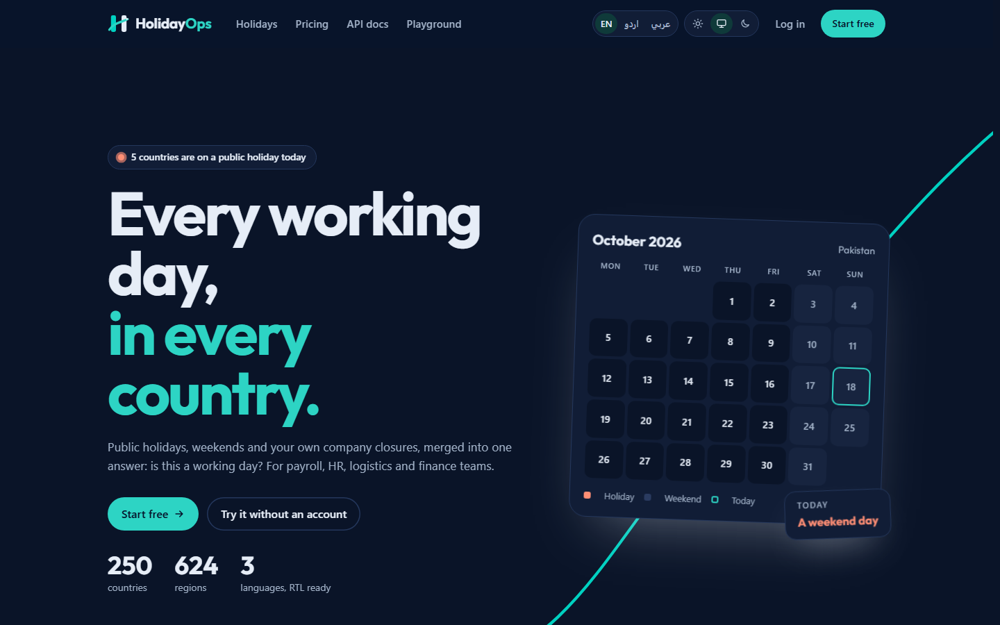
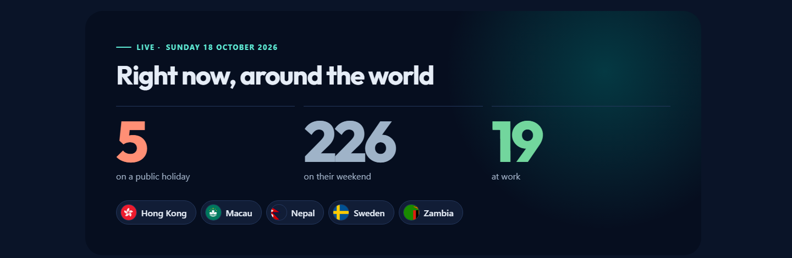
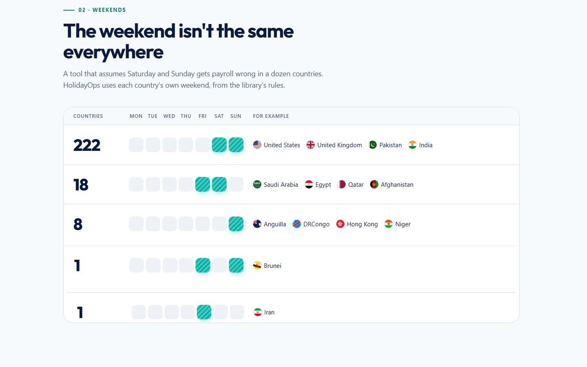
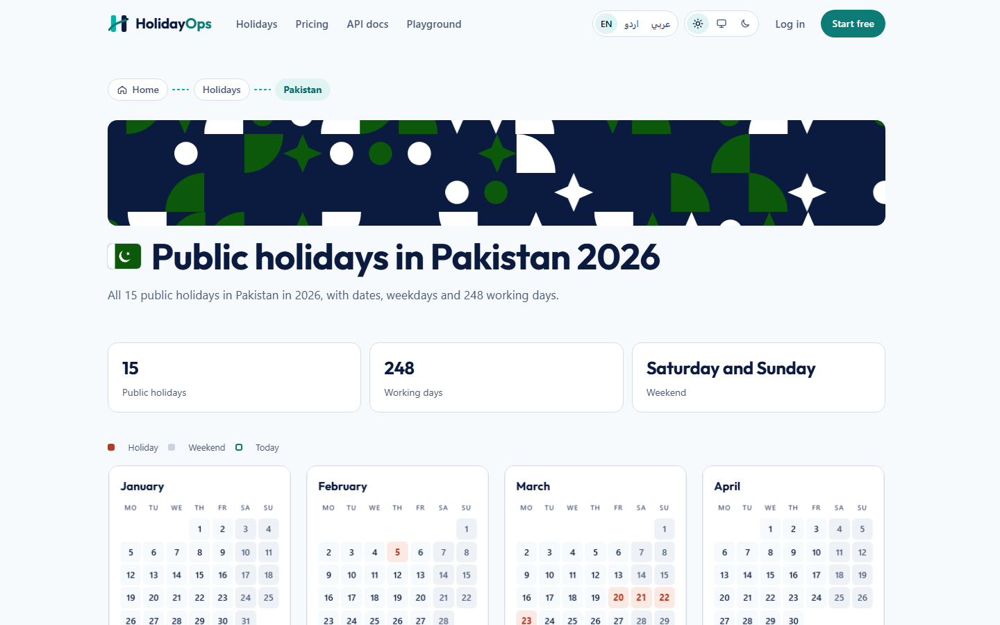
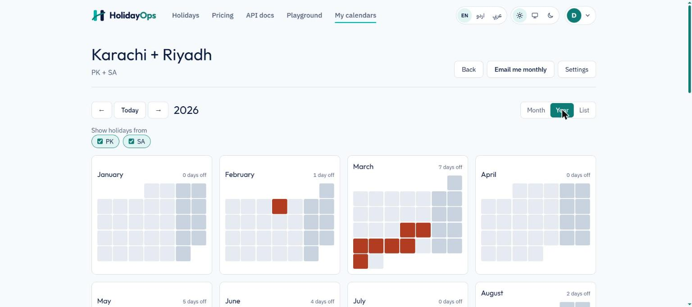
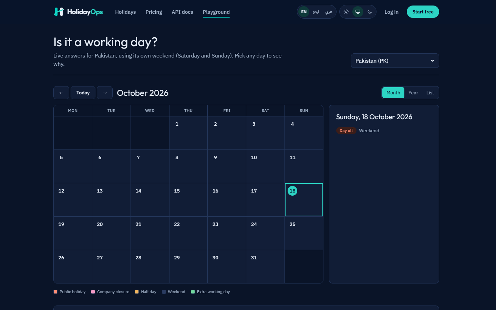
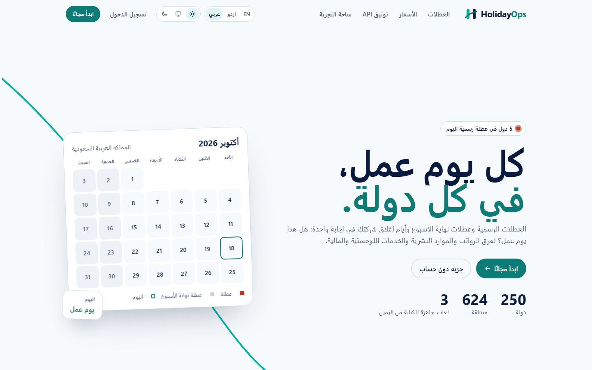
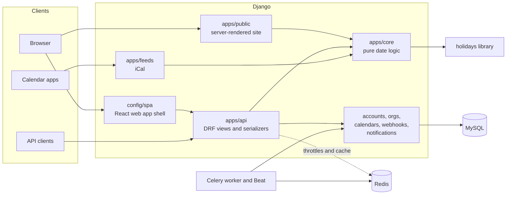
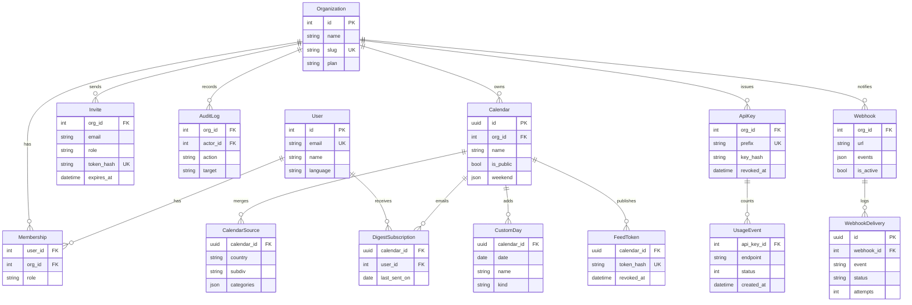

<p align="center">
  
</p>

<p align="center">
  <strong>Every working day, in every country.</strong><br>
  Public holidays, local weekends and your own company closures, merged into one answer.
</p>

<p align="center">
  <a href="https://github.com/ahmershahdev/holidayops/actions/workflows/ci.yml"></a>
  <a href="LICENSE"></a>
  
  
  
</p>

<p align="center">
  <a href="#features">Features</a> ·
  <a href="#screenshots">Screenshots</a> ·
  <a href="#architecture">Architecture</a> ·
  <a href="#getting-started">Getting started</a> ·
  <a href="#api">API</a> ·
  <a href="docs/">Docs</a> ·
  <a href="https://ahmershah.dev">Author</a>
</p>



## About

Is 2 April a working day in Riyadh? In Karachi? For a team with offices in both? The answer
depends on public holidays that follow the moon, weekends that differ between countries (Friday
and Saturday in Saudi Arabia, Saturday and Sunday in Pakistan), weekend days swapped for working
days, and closures that only your company knows about.

HolidayOps answers that question for 250 countries and 624 regions, through a REST API, a web app,
private iCal feeds, monthly email digests and signed webhooks. It is built for payroll, HR,
logistics and finance teams, and it speaks English, Urdu and Arabic.

Holiday data comes from the open-source [holidays](https://github.com/vacanza/holidays) library.
HolidayOps adds the business-day maths, company calendars, delivery channels and the product
around it.

> **Status:** feature-complete across six milestones; hosting is planned for launch. Progress is
> tracked in [docs/status.md](docs/status.md).

## Features

**Answers**

- Is a date a working day, and why: weekend, public holiday, or a weekend day moved to a working day.
- Add or subtract N working days; count working days between two dates (inclusive).
- Holiday lists by country, region, year, language and category.
- Each country's own weekend from the library's rules, including historical changes.

**Company calendars**

- Merge any countries and regions into one calendar.
- Add closures, half days and extra working days; every answer respects them.
- Organizations with owner, admin, member and viewer roles, email invites and an audit log.

**Delivery**

- REST API with OpenAPI 3 schema and Swagger UI.
- API keys (`hops_<prefix>_<secret>`) with per-key rate limits, monthly quotas and a usage chart.
- Private, revocable iCal feeds for Google Calendar, Outlook and Apple Calendar.
- Monthly email digest of the next 30 days, in the reader's language.
- HMAC-signed webhooks with retries, backoff and a delivery log.

**Web**

- React web app: month, year and list views, keyboard-navigable calendar, light and dark themes.
- Server-rendered public site: a live "who is off today" landing page, 250 country pages with
  flag-coloured patterns and full-year calendars, pricing, about and contact pages.
- English, Urdu and Arabic, with right-to-left layouts and CLDR names for countries, days and months.
- Installable as a PWA, with an offline fallback page.
- "Who is off today" for every country on its local date, an embeddable widget, and a
  working-day overlap tool for up to four countries.
- Public status page and changelog.

**Accounts and security**

- Two-factor sign-in (authenticator app, recovery codes), sign in with Google or Microsoft.
- Password reset by a one-time emailed code (Resend), self-serve data export and account deletion.

**SDKs**

- Python and TypeScript clients generated from the OpenAPI schema: [sdks/](sdks/).

## Screenshots

| | |
|---|---|
|  |  |
| Live: countries on a holiday or a weekend today | Weekend patterns across all 250 countries |
|  |  |
| Country page with the full-year calendar | Company calendar merging Pakistan and Saudi Arabia |
|  |  |
| Playground: live answers without an account | Arabic, right to left |

## Tech stack

| Layer | Tools |
|---|---|
| Domain | Python 3.12, [`holidays`](https://github.com/vacanza/holidays) (exact pin), Babel for CLDR data |
| Backend | Django 5.2 LTS, Django REST Framework, drf-spectacular, Argon2 |
| Data and jobs | MySQL 8 (utf8mb4), Redis, Celery and Celery Beat |
| Frontend | React, TypeScript (strict), Vite, Tailwind CSS, TanStack Query, React Router, i18next |
| Public site | Django templates, one stylesheet, CSS-only motion, no JavaScript |
| Quality | pytest, factory_boy, Vitest, Ruff, mypy, ESLint, Prettier |
| Delivery | Docker Compose, GitHub Actions, CodeQL, Dependabot, pip-audit, WhiteNoise, Gunicorn |

## Architecture



- **`apps/core` is plain Python** with no Django imports and 100% branch coverage. Views and
  serializers only call it, and it uses the library's own logic for weekends and working days.
- **Every org-owned query is filtered by the current organization.** Cross-organization access
  returns `404`, and a test tries it on every endpoint.
- **Public pages need no JavaScript.** They are cached per theme and language, and the web app is
  a separate React bundle served at `/playground` and `/app`.

### Data model



Field-level detail: [docs/architecture.md](docs/architecture.md).

## Getting started

Requirements: [uv](https://docs.astral.sh/uv/), Node.js 22.22 or newer, and Docker Desktop
(running).

```bash
git clone https://github.com/ahmershahdev/holidayops.git
cd holidayops
cp .env.example .env    # set DJANGO_SECRET_KEY, the MySQL passwords and DEMO_PASSWORD
npm install             # root tools
npm run setup           # frontend packages and Python packages
npm run dev             # MySQL and Redis in Docker; Django :8000, Vite :5173, Celery
npm run seed            # optional: demo user, organization and calendar
```

Open <http://localhost:5173>. The landing page and country pages come from Django; the playground
and the web app from Vite. API docs: <http://localhost:5173/api/v1/docs/>.

To run everything in containers instead: `docker compose up -d`. To try the production image:
`docker compose -f docker-compose.prod.yml up --build` (serves on port 8080).

## API

```http
GET /api/v1/countries/
GET /api/v1/holidays/?country=PK&year=2027&language=ur_PK
GET /api/v1/business-days/check/?country=SA&date=2027-04-02
GET /api/v1/business-days/add/?country=PK&date=2027-03-20&days=5
GET /api/v1/business-days/between/?country=AE&start=2027-01-01&end=2027-01-31
```

```json
{"date": "2027-04-02", "is_business_day": false, "reason": "weekend", "holidays": [], "half_day": false}
```

Anonymous calls are limited to 60 a minute per IP. With an API key
(`Authorization: Bearer hops_<prefix>_<secret>`) the plan's limits apply: Free gives 120 a minute
per key and 10,000 requests a month. Pass `calendar=<id>` instead of `country` to answer from a
company calendar. Contracts and limits: [docs/design/m1-api.md](docs/design/m1-api.md).

## Development

```bash
npm test                                  # backend (pytest, needs MySQL) and frontend (Vitest)
cd backend
uv run ruff check . && uv run ruff format --check . && uv run mypy .
uv run pytest tests/core --cov=apps/core --cov-branch --cov-fail-under=100
uv run python manage.py spectacular --file schema.yml --validate   # after API changes
cd ../frontend
npm run gen:api                           # regenerate the typed client from schema.yml
npm run lint && npm run typecheck
cd .. && npm run messages                 # after changing a template or gettext string
```

CI runs all of the above on every pull request, plus CodeQL and `pip-audit`.

## Project structure

```
backend/
  config/            settings (base, dev, test, prod), URLs, CSP, Celery, health check
  apps/core/         pure date logic: calendars, business days, merging, iCal
  apps/api/          public API: views, serializers, throttles, API keys, usage
  apps/accounts/     users and session auth
  apps/orgs/         organizations, roles, invites, audit log, limits
  apps/calendars/    company calendars, sources and custom days
  apps/feeds/        private iCal feeds
  apps/notifications/ monthly digests
  apps/webhooks/     signed webhooks with an SSRF guard
  apps/public/       server-rendered site, SEO, sitemaps, llms.txt, PWA
  tests/             mirrors apps/
frontend/src/        api/ (generated client), components/, pages/, i18n/, lib/
docs/                architecture, security, SEO, deployment, roadmap, design notes
```

## Security

- Passwords hashed with Argon2; API keys, feed links and invite tokens stored only as hashes.
- Strict tenant isolation, tested on every organization endpoint.
- Rate limits per IP, per key and per organization, with correct client IPs behind proxies.
- Count-then-create limits taken under a database lock, so parallel requests can't exceed them.
- Webhooks: HMAC-SHA256 signatures, HTTPS only, SSRF guard that pins the vetted IP address.
- Content Security Policy on every response; the public pages allow no script at all.
- Security events logged without secrets; exact-pinned dependencies, Dependabot, CodeQL.

Details: [docs/security.md](docs/security.md). To report a vulnerability, see
[SECURITY.md](SECURITY.md).

## SEO and discoverability

- Server-rendered pages with titles under 60 characters and descriptions under 150, checked by tests
  for every page and every country and region in all three languages.
- Canonical URLs, `hreflang` for en, ur and ar, Open Graph and large Twitter cards.
- Breadcrumbs with `BreadcrumbList` JSON-LD; `Organization`, `WebSite`, `WebApplication` and
  `FAQPage` on the landing page; one `Event` per holiday on country pages.
- `sitemap.xml` with per-country sections, `robots.txt`, `llms.txt` and `llms-full.txt`.
- Web app manifest and service worker.

Details: [docs/seo.md](docs/seo.md).

## Documentation

| Document | Covers |
|---|---|
| [docs/status.md](docs/status.md) | What is done and what is open |
| [docs/architecture.md](docs/architecture.md) | Domain layer, endpoints, data model, caching |
| [docs/security.md](docs/security.md) | Auth, tenancy, limits, webhooks, headers |
| [docs/seo.md](docs/seo.md) | Public pages, structured data, discovery files |
| [docs/deployment.md](docs/deployment.md) | Production image, Azure, CD |
| [docs/roadmap.md](docs/roadmap.md) | Milestones and what comes next |
| [docs/design/](docs/design/) | Design notes per milestone |
| [AGENTS.md](AGENTS.md) | Conventions for contributors and coding agents |

## Contributing

Contributions are welcome. Read [CONTRIBUTING.md](CONTRIBUTING.md) for setup, conventions and the
pull request checklist. Wrong holiday dates usually come from the upstream
[holidays](https://github.com/vacanza/holidays) library; reporting them there fixes them for
everyone.

## Author

HolidayOps is designed and built by **Syed Ahmer Shah**.

- Website: [ahmershah.dev](https://ahmershah.dev)
- Support: [support@ahmershah.dev](mailto:support@ahmershah.dev)
- GitHub: [@ahmershahdev](https://github.com/ahmershahdev)

## License

[MIT](LICENSE) © 2026 Syed Ahmer Shah. Country flags from
[flag-icons](https://github.com/lipis/flag-icons) (MIT); fonts under the SIL Open Font License.
